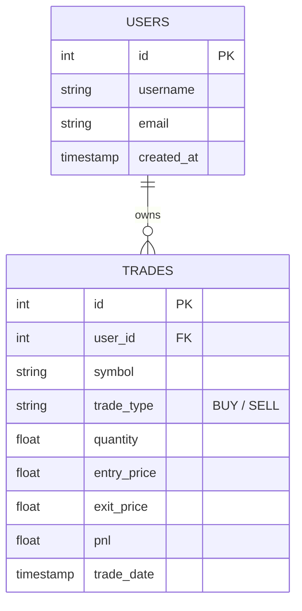

# 📈 Trade Analysis Dashboard

<div align="center">

[](https://python.org)
[](https://flask.palletsprojects.com/)
[](https://sqlite.org)
[](https://vercel.com)
[](https://opensource.org/licenses/MIT)

**Full-Stack Trading Performance Analytics Platform with SQL Terminal & Portfolio PnL Tracking**

</div>

---

## 📖 Overview

The **Trade Analysis Dashboard** is a high-performance web platform built with Flask and SQLite to track stock positions, compute real-time profit and loss (PnL), visualize historical return distributions, and execute raw analytical queries via an integrated SQL sandbox.

---

## 🏗️ System Architecture & Data Flow

```mermaid
flowchart TD
    User([Trader / Analyst]) --> WebUI[Web Interface / Dashboard UI]
    
    subgraph Frontend Layer
        WebUI --> MetricsView[Portfolio Metrics & Win-Rate Cards]
        WebUI --> ChartView[Interactive Chart.js PnL Graphs]
        WebUI --> SQLTerminal[In-Browser SQL Query Console]
        WebUI --> ImportModal[CSV / Excel Trade Importer]
    end

    subgraph Backend Routing (Flask)
        MetricsView & ChartView --> AppRoutes[Flask Application Core - app.py]
        SQLTerminal --> QueryEngine[Safe SQL Query Execution Engine]
        ImportModal --> FileParser[Pandas / CSV Ingestion Pipeline]
    end

    subgraph Database Layer
        AppRoutes & QueryEngine & FileParser --> SQLiteDB[(SQLite Database - schema.sql)]
        SQLiteDB --> UsersTable[users]
        SQLiteDB --> TradesTable[trades]
    end
```

---

## 🗄️ Database Schema



---

## ✨ Core Capabilities

- **Real-Time Portfolio PnL**: Automatically computes unrealized and realized gain/loss across open and closed positions.
- **Interactive SQL Sandbox**: Execute custom SELECT queries directly against your trading database to extract tailored insights.
- **Bulk CSV / Excel Ingestion**: Import execution logs from brokers with schema mapping.
- **Serverless Ready**: Configured with `vercel.json` and WSGI wrapper for immediate cloud deployment.

---

## 🚀 Quickstart

### 1. Clone & Setup Virtual Environment
```bash
git clone https://github.com/shrikargs7-cloud/trade-analysis-dashboard.git
cd trade-analysis-dashboard

python3 -m venv venv
source venv/bin/activate
pip install -r requirements.txt
```

### 2. Initialize Database
```bash
python3 -c "import sqlite3; conn = sqlite3.connect('trades.db'); conn.executescript(open('schema.sql').read()); conn.close()"
```

### 3. Launch App
```bash
python3 app.py
```
Open [http://localhost:5000](http://localhost:5000) in your browser.

---

## 📄 License
MIT License © [Shrikar G S](https://github.com/shrikargs7-cloud)
